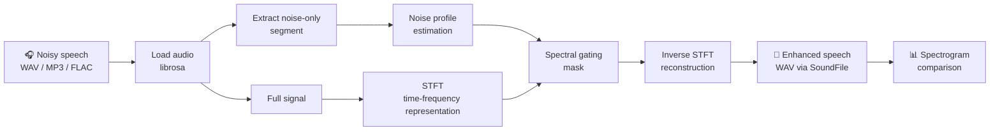
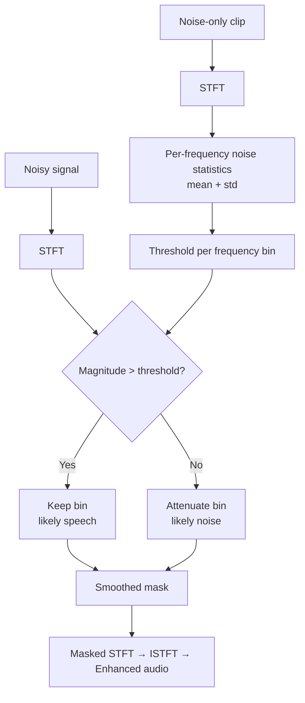

<div align="center">

# 🎙️ Speech Enhancement using Digital Signal Processing

**A lightweight, reproducible Python pipeline for suppressing background noise in speech recordings using spectral gating.**


</div>

---

## 📌 Overview

Background noise degrades the intelligibility of speech and the accuracy of downstream systems such as automatic speech recognition (ASR). This project implements a **classical DSP baseline** for speech enhancement:

1. Estimate a noise profile from a noise-only segment of the recording.
2. Transform the signal to the time-frequency domain (STFT).
3. Attenuate time-frequency bins that fall below the noise threshold (spectral gating).
4. Reconstruct the enhanced waveform and export it as WAV.

It is intended as a clear, well-documented starting point for experiments, and as a **baseline** to compare against learned (deep-learning) enhancement models.

> **Scope note:** This is a signal-processing baseline, not a trained neural model. See [Limitations](#-limitations) and [Roadmap](#-roadmap).

---

## 🏗️ Architecture

### End-to-end pipeline



### Spectral gating (conceptual)



### Repository structure

```text
speech-enhancement-dsp/
├── enhance.py            # Enhancement pipeline (CLI)
├── visualize.py          # Waveform + spectrogram comparison generator
├── requirements.txt      # Python dependencies
├── assets/               # Generated figures used in this README
│   └── comparison.png
├── .gitignore
└── README.md
```

---

## 🧠 Method

| Stage | Technique | Purpose |
|-------|-----------|---------|
| Loading | `librosa.load` | Decode audio and obtain samples + sample rate |
| Noise profiling | First *N* seconds of the recording | Estimate the noise floor per frequency bin |
| Analysis | Short-Time Fourier Transform (STFT) | Time-frequency representation of the signal |
| Suppression | Spectral gating (`noisereduce`) | Attenuate bins dominated by noise |
| Synthesis | Inverse STFT | Reconstruct the time-domain waveform |
| Export | `soundfile.write` | Save the enhanced signal as WAV |

**Key parameters**

| Parameter | Default | Description |
|-----------|---------|-------------|
| `--noise-duration` | `1.0` s | Length of the initial noise-only segment |
| `prop_decrease` | `0.8` | How strongly detected noise is attenuated (0–1) |
| `stationary` | `False` | Adapts to slowly varying noise instead of assuming constant noise |

---

## 📊 Results

The figure below compares the **waveform** and **spectrogram** of the noisy input against the enhanced output. It is generated by `visualize.py` from your own recording.


*What to look for: reduced energy in noise-dominated time-frequency regions of the spectrogram while speech harmonics remain visible.*

> Quantitative evaluation (e.g., PESQ, STOI, SI-SDR) requires clean reference audio and is listed under the [Roadmap](#-roadmap). No objective scores are claimed for this baseline.

---

## 🚀 Getting Started

### Prerequisites

- Python 3.9+
- `pip`

### Installation

```bash
git clone https://github.com/vishal-mundewadi/speech-enhancement-dsp.git
cd speech-enhancement-dsp

python -m venv .venv
source .venv/bin/activate        # Windows: .venv\Scripts\activate

pip install -r requirements.txt
```

### Usage

**Enhance a recording**

```bash
python enhance.py noisy_speech.wav -o enhanced.wav
```

**If the noise-only opening is longer than one second**

```bash
python enhance.py noisy_speech.wav -o enhanced.wav --noise-duration 2.0
```

**Generate the comparison figure**

```bash
python visualize.py noisy_speech.wav enhanced.wav -o assets/comparison.png
```

### Recording tips

- Start the recording with **1–2 seconds of silence** (background noise only), then begin speaking.
- Use a mono, 16 kHz or higher recording.
- Avoid including speech in the noise-reference segment.

---

## ⚠️ Limitations

- A **classical DSP baseline**; it does not learn speech priors the way neural models do.
- Assumes the noise-only segment is representative of the noise throughout the recording.
- Performs best on relatively steady noise (fan, hum, room noise); less effective on babble or sudden non-stationary noise.
- Aggressive settings can cause **musical noise** artifacts or suppress low-energy speech such as fricatives.

---

## 🗺️ Roadmap

- [x] Spectral-gating enhancement CLI
- [x] Waveform and spectrogram comparison script
- [ ] Evaluate on a documented dataset with paired clean/noisy speech
- [ ] Objective metrics: PESQ, STOI, SI-SDR
- [ ] Experiment tracking and reproducible configuration files
- [ ] Compare against a PyTorch-based enhancement model
- [ ] Downstream ASR word-error-rate comparison before vs after enhancement

---

## 🛠️ Tech Stack

- **Python**
- **librosa** – audio loading and spectral analysis
- **noisereduce** – spectral gating noise reduction
- **SoundFile** – WAV export
- **Matplotlib** – visualization

---

## 📚 References

- Boll, S. F. (1979). *Suppression of acoustic noise in speech using spectral subtraction.* IEEE Transactions on Acoustics, Speech, and Signal Processing.
- McFee, B. et al. *librosa: Audio and music signal analysis in Python.* Proceedings of the SciPy Conference, 2015.
- Sainburg, T. et al. *noisereduce: Noise reduction in Python* (open-source library).

---

## 👤 Author

**Vishal Mundewadi**
[LinkedIn](https://linkedin.com/in/vishal-mundewadi) · [GitHub](https://github.com/vishal-mundewadi)

---

## 📄 License

Released under the MIT License. See `LICENSE` for details.
